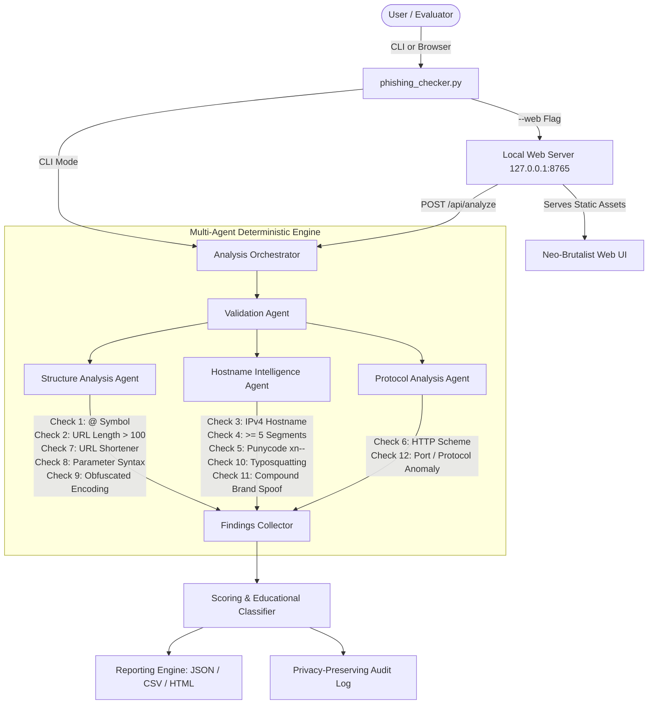
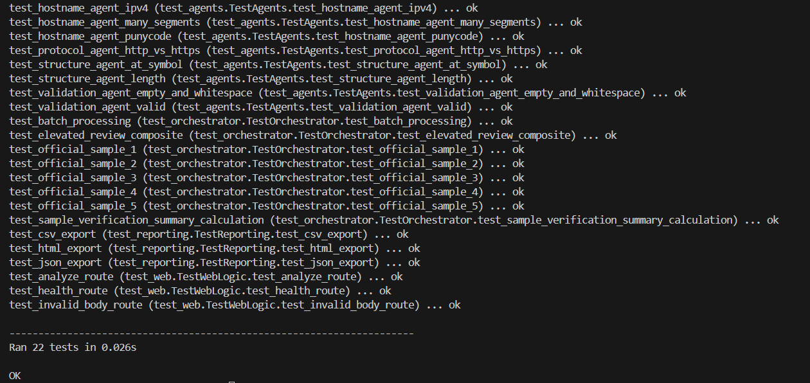
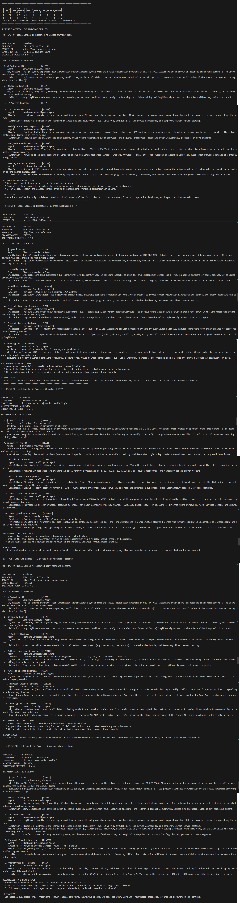
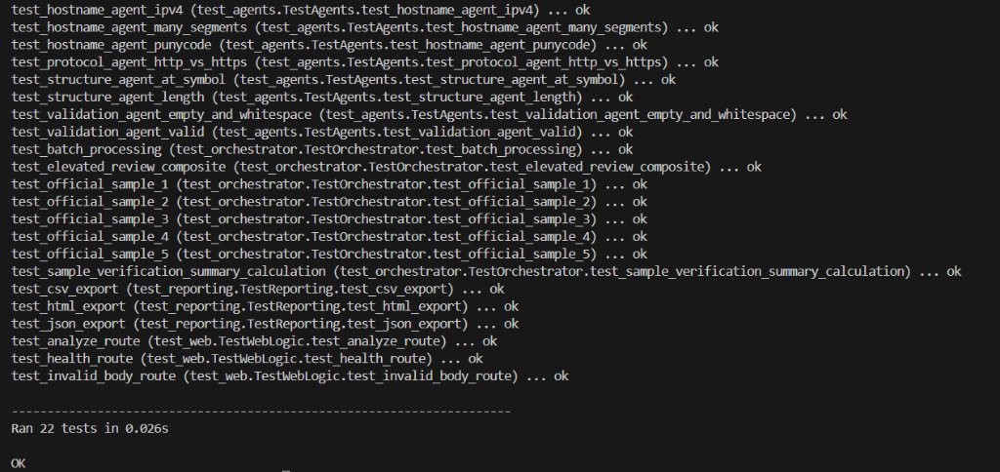

# PHISHGUARD — Phishing URL Awareness & Intelligence Platform

> **"Don't trust the link. Understand it."**  
> *Defensive Cybersecurity Education & Offline Heuristic URL Analysis*

[](https://github.com)
[](https://www.python.org/)
[](web/styles.css)
[](tests/test_samples.md)
[](LICENSE)
[](tests/test_samples.md)

---

## 1. Project Overview & Problem Statement

Phishing campaigns continue to represent one of the primary attack vectors in modern social engineering. Threat actors routinely craft deceptive web links designed to mimic legitimate institutions, taking advantage of interface constraints—such as URL truncation in mobile web browsers and email clients—to obscure actual destination domains.

**PhishGuard** is a defensive, local-first cybersecurity awareness application developed in strict compliance with the **EWB Cybersecurity Mini Project Workbook**. It performs deterministic, offline syntactic analysis of suspicious URLs to educate users, students, and security analysts on the mechanical anatomy of deceptive links.

> **CRITICAL EDUCATIONAL & DEFENSIVE NOTICE:**  
> PhishGuard is an educational awareness tool designed for static structural inspection. It does **not** visit, scan, probe, or transmit target URLs across the network.  
> - **The absence of listed warning signs does NOT guarantee that a URL is safe.**  
> - **The presence of HTTPS does NOT prove a website is trustworthy.**  
> - PhishGuard never claims that a URL is definitively safe or definitively malicious based on structural indicators alone.

---

## 2. Project Objectives

- **Workbook Deliverable Compliance**: Retain the mandatory entry-point filename `phishing_checker.py` and satisfy all official EWB evaluation criteria.
- **Explainable Defensive Intelligence**: Deconstruct link structures and explain *why* specific anomalies warrant attention and what their limitations are.
- **Offline & Privacy-Preserving by Design**: Operate strictly without live DNS resolution, network socket probes, or external threat API calls.
- **Transparent Classification**: Categorize links based on observable indicator counts rather than uncalibrated probabilities or opaque machine-learning scores.
- **High-Quality Dual Interface**: Provide both an interactive terminal CLI and an accessible, single-page Neo-Brutalist browser interface.

---

## 3. System Architecture

The following diagram illustrates the unidirectional, offline data flow of the PhishGuard platform:



---

## 4. Multi-Agent Architecture & Responsibilities

PhishGuard partitions its inspection tasks across four deterministic software agents. Each agent acts as an independent, testable module with clearly bounded responsibilities:

1. **Validation Agent (`phishguard/agents/validation_agent.py`)**:
   - Safely parses and normalizes raw text inputs without executing or querying targets.
   - Sanitizes URL strings for local audit logs by stripping sensitive query parameters, credentials, and fragments.
   - Handles edge cases such as empty inputs, whitespace, malformed IPv6 brackets, and missing URI schemes.

2. **Structure Analysis Agent (`phishguard/agents/structure_agent.py`)**:
   - Inspects URL length, authority delimiters, link-shortening domains, query string structures, and path encoding.

3. **Hostname Intelligence Agent (`phishguard/agents/hostname_agent.py`)**:
   - Analyzes hostnames for direct IPv4 addresses, segment count anomalies, Punycode encoding, visual typosquatting, and deceptive subdomain chaining.

4. **Protocol Analysis Agent (`phishguard/agents/protocol_agent.py`)**:
   - Evaluates scheme encryption (HTTP vs. HTTPS) and flags non-standard network ports or non-web protocols.

---

## 5. Complete Heuristic Detectors (12 Checks)

PhishGuard implements the **6 mandatory workbook checks** alongside **6 advanced defensive heuristics** for comprehensive structural coverage:

| # | Check Identifier | Heuristic Name | Agent | Description & Significance |
|:---:|:---|:---|:---|:---|
| **1** | `CHECK_1_AT_SYMBOL` | `@` Symbol in URL *(Mandatory EWB)* | Structure Agent | Detects URI RFC 3986 user-information syntax where an attacker places a trusted brand before `@` to obscure the actual host. |
| **2** | `CHECK_2_URL_LENGTH` | Unusually Long URL (> 100) *(Mandatory EWB)* | Structure Agent | Flags URLs exceeding 100 characters that may push destination hostnames outside visible mobile address bars. |
| **3** | `CHECK_3_IPV4_HOST` | IP Address Hostname *(Mandatory EWB)* | Hostname Agent | Identifies raw numeric IPv4 hostnames using Python's `ipaddress` module, often used to bypass domain reputation systems. |
| **4** | `CHECK_4_MANY_SEGMENTS` | Multiple Hostname Segments ($\ge 5$) *(Mandatory EWB)* | Hostname Agent | Identifies hostnames with 5 or more dot-separated segments, often used to chain subdomains mimicking authentic services. |
| **5** | `CHECK_5_PUNYCODE` | Punycode Encoded Hostname *(Mandatory EWB)* | Hostname Agent | Flags `xn--` Internationalized Domain Name prefixes to highlight potential homograph attacks using visually similar characters. |
| **6** | `CHECK_6_HTTP_SCHEME` | Unencrypted HTTP Scheme *(Mandatory EWB)* | Protocol Agent | Identifies plain HTTP transmitting cleartext credentials, while noting that modern phishing also uses valid HTTPS. |
| **7** | `ADV_URL_SHORTENER` | URL Shortening Service | Structure Agent | Detects known link-shortening services (`bit.ly`, `tinyurl.com`, `t.co`, etc.) that hide the true destination domain. |
| **8** | `ADV_SUSPICIOUS_PARAMS` | Suspicious Query / Parameter Syntax | Structure Agent | Flags static query patterns containing secondary URLs or urgent session triggers (`redirect=`, `session=expired`, `token=`). |
| **9** | `ADV_SUSPICIOUS_ENCODING` | Obfuscated Encoding & Path Anomalies | Structure Agent | Statically detects directory traversal (`../`), embedded `<script>` tags, and heavy hex-encoded ASCII in paths. |
| **10** | `ADV_TYPOSQUATTING` | Typosquatting & Lookalike Domain | Hostname Agent | Uses Levenshtein distance and leetspeak substitution (`0`$\to$`o`, `1`$\to$`l`) to detect counterfeit brand spellings. |
| **11** | `ADV_MISLEADING_DOMAIN_STRUCTURE` | Misleading Brand Subdomain / Compound Domain | Hostname Agent | Flags brand names placed in subdomains when the root domain differs, or hyphenated brand lures (`microsoft-login-verify.com`). |
| **12** | `ADV_PROTOCOL_PORT_ANOMALY` | Non-Standard Port or Protocol Scheme | Protocol Agent | Identifies unusual web ports (`:8443`, `:8080`) or non-HTTP schemes (`ftp://`) frequently associated with evasion techniques. |

---

## 6. Educational Scoring Model

PhishGuard avoids artificial machine-learning confidence scores and instead relies on a deterministic indicator-count model:

- **0 Indicators Flagged**: `NO LISTED WARNING SIGNS`  
  *Educational Notice: No structural indicators were flagged. This does not prove the link is legitimate.*
- **1 – 2 Indicators Flagged**: `REVIEW`  
  *Educational Notice: One or two structural warning signs detected. Manual verification is advised before interacting.*
- **3 or More Indicators Flagged**: `ELEVATED REVIEW`  
  *Educational Notice: Multiple structural anomalies present. Exercise extreme caution and verify the source independently.*

---

## 7. Technology Stack & Requirements

- **Runtime**: Python 3.10, 3.11, or 3.12.
- **Core Dependencies**: Zero external runtime dependencies. Built exclusively using the Python Standard Library (`urllib.parse`, `ipaddress`, `http.server`, `unittest`, `dataclasses`, `json`, `csv`).
- **Optional Development Tooling**: `ruff>=0.1.0` (specified in `requirements.txt`).
- **Frontend**: Native HTML5, CSS3 (Neo-Brutalist design tokens), and Vanilla JavaScript (strict DOM construction with `textContent`).
- **CI/CD**: GitHub Actions workflow (`.github/workflows/python-tests.yml`).

---

## 8. Installation & Setup (Windows PowerShell)

### Step 1: Clone the Repository
```powershell
git clone https://github.com/placeholder-user/phishguard.git
cd phishguard
```

### Step 2: Verify Python
Ensure Python 3.10 or higher is available in your PATH:
```powershell
python --version
```

### Step 3: (Optional) Install Development Tools
```powershell
python -m pip install --upgrade pip
pip install -r requirements.txt
```

---

## 9. Usage Instructions

### CLI Mode

#### 1. Run the Five Official EWB Workbook Samples
Executes all five required samples, prints findings for each, and generates a dynamic pass/fail summary:
```powershell
python phishing_checker.py --samples
```

#### 2. Inspect a Single URL
```powershell
python phishing_checker.py "http://192.0.2.10/account"
```

#### 3. Output Analysis in Pure JSON (for programmatic ingestion)
```powershell
python phishing_checker.py "https://microsoft-login-verification.com" --json
```

#### 4. Interactive Command Prompt
```powershell
python phishing_checker.py
```
*(Type `samples` to run workbook verification, or `exit` to close).*

---

### Local Web Interface

Launch the local web server:
```powershell
python phishing_checker.py --web
```
Open your web browser and navigate to:  
👉 **`http://127.0.0.1:8765`**

#### Web Features
- **URL Inspector**: Single-click inspection with workbook sample shortcuts and color-coded Neo-Brutalist findings.
- **Batch Analysis**: Analyze up to 50 URLs separated by newlines with live statistical rollups and CSV/JSON export.
- **Audit History**: Review past inspections with sanitized hostnames stored in `reports/audit_history.json`.
- **Educational Guide**: In-depth explanations of all detection methods and their defensive limitations.

---

## 10. Reporting & Export Capabilities

PhishGuard provides multi-format export capabilities for documentation and review:

1. **JSON Export (`ReportGenerator.to_json`)**: Full programmatic output containing metadata, parsed URL components, indicator counts, and all 12 individual check findings.
2. **CSV Export (`ReportGenerator.to_csv`)**: Tabular export suitable for batch analysis, logging Analysis ID, timestamp, sanitized endpoint, classification, and flagged indicators.
3. **HTML Export (`ReportGenerator.to_html`)**: Standalone, styled Neo-Brutalist report card displaying findings, limitations, and safe next steps.

---

## 11. Official EWB Workbook Sample Results

Verified using `python phishing_checker.py --samples`:

| Sample # | Input URL | Expected Flagged Indicators | Expected Classification | Actual Status |
|:---:|:---|:---|:---:|:---:|
| **Sample 1** | `https://www.example.com/login` | None | `NO LISTED WARNING SIGNS` | **PASS** |
| **Sample 2** | `http://192.0.2.10/account` | `CHECK_3_IPV4_HOST`, `CHECK_6_HTTP_SCHEME` | `REVIEW` | **PASS** |
| **Sample 3** | `http://example.com@sample.invalid/login` | `CHECK_1_AT_SYMBOL`, `CHECK_6_HTTP_SCHEME` | `REVIEW` | **PASS** |
| **Sample 4** | `https://a.b.c.d.e.example.invalid/path` | `CHECK_4_MANY_SEGMENTS` | `REVIEW` | **PASS** |
| **Sample 5** | `https://xn--example.invalid/` | `CHECK_5_PUNYCODE` | `REVIEW` | **PASS** |

Verification Summary:
```text
===========================================================================
OFFICIAL EWB SAMPLE VERIFICATION
Total Samples: 5
Passed: 5
Failed: 0
Overall: PASS
===========================================================================
```

---

## 12. Automated Testing Suite

The complete test suite runs via standard Python `unittest`:

```powershell
python -m unittest discover -s tests -p "test_*.py" -v
```

### Actual Test Execution Output (29 Tests)
```text
test_adv_misleading_domain_structure (test_agents.TestAgents.test_adv_misleading_domain_structure) ... ok
test_adv_non_standard_port_or_protocol (test_agents.TestAgents.test_adv_non_standard_port_or_protocol) ... ok
test_adv_suspicious_encoding (test_agents.TestAgents.test_adv_suspicious_encoding) ... ok
test_adv_suspicious_parameters (test_agents.TestAgents.test_adv_suspicious_parameters) ... ok
test_adv_typosquatting (test_agents.TestAgents.test_adv_typosquatting) ... ok
test_adv_url_shortener (test_agents.TestAgents.test_adv_url_shortener) ... ok
test_benign_urls_zero_flags (test_agents.TestAgents.test_benign_urls_zero_flags) ... ok
test_hostname_agent_ipv4 (test_agents.TestAgents.test_hostname_agent_ipv4) ... ok
test_hostname_agent_many_segments (test_agents.TestAgents.test_hostname_agent_many_segments) ... ok
test_hostname_agent_punycode (test_agents.TestAgents.test_hostname_agent_punycode) ... ok
test_protocol_agent_http_vs_https (test_agents.TestAgents.test_protocol_agent_http_vs_https) ... ok
test_structure_agent_at_symbol (test_agents.TestAgents.test_structure_agent_at_symbol) ... ok
test_structure_agent_length (test_agents.TestAgents.test_structure_agent_length) ... ok
test_validation_agent_empty_and_whitespace (test_agents.TestAgents.test_validation_agent_empty_and_whitespace) ... ok
test_validation_agent_valid (test_agents.TestAgents.test_validation_agent_valid) ... ok
test_batch_processing (test_orchestrator.TestOrchestrator.test_batch_processing) ... ok
test_elevated_review_composite (test_orchestrator.TestOrchestrator.test_elevated_review_composite) ... ok
test_official_sample_1 (test_orchestrator.TestOrchestrator.test_official_sample_1) ... ok
test_official_sample_2 (test_orchestrator.TestOrchestrator.test_official_sample_2) ... ok
test_official_sample_3 (test_orchestrator.TestOrchestrator.test_official_sample_3) ... ok
test_official_sample_4 (test_orchestrator.TestOrchestrator.test_official_sample_4) ... ok
test_official_sample_5 (test_orchestrator.TestOrchestrator.test_official_sample_5) ... ok
test_sample_verification_summary_calculation (test_orchestrator.TestOrchestrator.test_sample_verification_summary_calculation) ... ok
test_csv_export (test_reporting.TestReporting.test_csv_export) ... ok
test_html_export (test_reporting.TestReporting.test_html_export) ... ok
test_json_export (test_reporting.TestReporting.test_json_export) ... ok
test_analyze_route (test_web.TestWebLogic.test_analyze_route) ... ok
test_health_route (test_web.TestWebLogic.test_health_route) ... ok
test_invalid_body_route (test_web.TestWebLogic.test_invalid_body_route) ... ok
----------------------------------------------------------------------
Ran 29 tests in 0.034s

OK
```

---

## 13. Benign URL Regression Suite

To guard against false positives, legitimate production URLs are evaluated in `test_benign_urls_zero_flags`. All produce zero flagged indicators:

- `https://www.microsoft.com` $\to$ `0 / 12` (`NO LISTED WARNING SIGNS`)
- `https://www.github.com` $\to$ `0 / 12` (`NO LISTED WARNING SIGNS`)
- `https://www.wikipedia.org` $\to$ `0 / 12` (`NO LISTED WARNING SIGNS`)
- `https://www.amazon.com` $\to$ `0 / 12` (`NO LISTED WARNING SIGNS`)
- `https://www.stackoverflow.com` $\to$ `0 / 12` (`NO LISTED WARNING SIGNS`)
- `https://docs.python.org/3/library/unittest.html` $\to$ `0 / 12` (`NO LISTED WARNING SIGNS`)
- `https://developer.mozilla.org/en-US/docs/Web/HTTP` $\to$ `0 / 12` (`NO LISTED WARNING SIGNS`)

---

## 14. Visual Design & Application Screenshots

The repository includes visual design artwork, screenshots of the live interface, and execution evidence stored under `screenshots/`:

### 1. PhishGuard Defensive Intelligence Banner
  
*Figure 1: Neo-Brutalist editorial concept illustrating URL inspection, structural heuristic analysis, and link safety awareness.*

### 2. Multi-Agent Inspection Architecture
  
*Figure 2: Deterministic multi-agent analysis topology (Structure, Hostname, Protocol, and Validation modules).*

### 3. Local Web Interface (URL Inspector)
  
*Figure 3: Neo-Brutalist browser interface running locally on `http://127.0.0.1:8765`.*

### 4. Official Workbook Sample Run (CLI)
  
*Figure 4: Full terminal execution of `python phishing_checker.py --samples` displaying heuristic findings for all five workbook samples and the verification summary.*

### 5. Automated Test Suite Execution
  
*Figure 5: Execution of the complete unit test suite validating all 29 automated tests.*

---

## 15. Privacy, Ethics & Defensive Scope

1. **Defensive Learning Only**: PhishGuard must not be used for malicious purposes, credential harvesting, unauthorized intelligence gathering, or offensive security operations.
2. **Offline-First Privacy**: Target URLs are parsed strictly in local memory. No packets are transmitted to target servers.
3. **Data Sanitization**: The local audit logger automatically strips sensitive parameters, authentication tokens, and user credentials before persisting session records.
4. **No Vulnerability Claims**: Static parameter detection identifies suspicious syntax patterns but does not claim to prove active vulnerabilities or live open redirects.

---

## 16. Limitations & Future Roadmap

### Known Limitations
- **Static Heuristics Only**: Does not evaluate domain registration age, DNS TXT/SPF/DMARC records, or SSL certificate transparency logs.
- **No Dynamic Rendering**: Does not execute JavaScript or analyze DOM elements on the destination website.
- **Shortener Transparency**: Flags shortening services as an obfuscation risk but cannot inspect the hidden target without resolving the redirect.

### Future Roadmap
- Integration with local, offline threat intelligence feeds (e.g., hash-based blocklists).
- Optional, opt-in local WHOIS lookup integration.
- Expanded homograph detection across additional non-Latin scripts.

---

## 17. License

This project is licensed under the **MIT License**. See [`LICENSE`](LICENSE) for complete terms.

---

## 18. Authors & Project Credits

- **Engineering**: Developed for the **EWB Cybersecurity Mini Project**.
- **Specifications**: Built strictly in accordance with the *EWB Cybersecurity Mini Project Workbook*.
- **Design Inspiration**: Neo-Brutalist typography and independent editorial software aesthetics.
